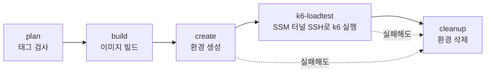
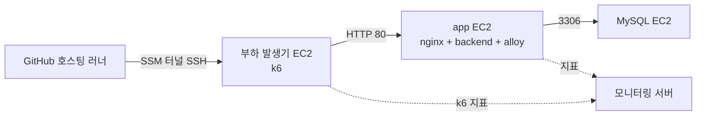

# 부하 테스트 전용 환경

부하 발생기, 앱(nginx + backend), MySQL을 EC2 3대로 만든다. 태그를 푸시하면 매번 새 환경을 만들어 k6를 실행하고, 결과와 상관없이 환경을 지운다. dev와 운영에는 부하를 보내지 않는다.

| 파일 | 역할 |
| --- | --- |
| `loadtest-environment.yaml` | CloudFormation 템플릿. VPC·서브넷, EC2 3대, 보안 그룹, SSM 접속용 역할 |
| `compose.app.yml` | 앱 서버 compose. 운영 compose에서 TLS·certbot을 뺐다 |
| `nginx.default.conf.template` | HTTP 전용 nginx 설정. 제한값은 파라미터로 바꾼다 |
| `params/<회차>.params` | (선택) 그 회차에서 바꿀 템플릿 파라미터 |
| `.github/workflows/load-test.yml` | 태그 하나로 `plan` → `build` → `create` → `k6-loadtest` → `cleanup`을 실행 |

## 실행

```bash
git tag k6/loadtest/<스크립트>/<회차> <커밋>
git push origin k6/loadtest/<스크립트>/<회차>
```

- `<스크립트>`: `smoke-test`, `smoke-ai-test`, `ttft-ai-test`, `breakpoint-general-test`, `breakpoint-ai-arrival-test`, `breakpoint-ai-concurrency-test` 중 하나. 새 스크립트는 `load-test.yml`의 `plan` 잡 정규식에 추가한다.
- `<회차>`: 소문자·숫자·하이픈 24자 이내. 회차마다 새 스택을 만들므로 같은 이름의 스택이 있으면 `create`가 실패한다.
- 태그가 가리키는 커밋이 테스트 대상이다. `build` 잡이 그 커밋의 `BE/`로 arm64 이미지를 새로 만들어 `loadtest-<커밋 SHA>` 태그로 Docker Hub에 올리고(CD의 이미지와 겹치지 않는다), 템플릿과 compose·nginx 파일도 같은 커밋 기준이다. 병합이나 CD를 기다릴 필요가 없다. 이미지는 쌓이므로 필요하면 Docker Hub에서 `loadtest-*` 태그를 정리한다.



`cleanup`은 앞 잡이 실패해도 실행되지만, `create`의 확인(이미지, 기존 스택)을 통과해 이 실행이 스택의 주인일 때만 지운다. 같은 이름의 스택이 이미 있어서 실패한 경우에는 그 스택을 건드리지 않는다. 비밀값 파일(`~/k6-run/.env`)은 환경과 함께 사라진다.

## 회차 조건 바꾸기

환경이 테스트 직후 지워지므로 값은 태그가 가리키는 커밋에 둔다. `Infra/loadtest/params/<회차>.params`를 만들어 커밋한 뒤 그 커밋에 태그를 단다. 파일이 없으면 기본값이다.

```text
# params/q4-r1.params
LoadTestThrottleRatio=1.0
DbPoolSize=5
```

한 줄에 `파라미터=값` 하나이고, 허용 목록의 이름만 받는다: `AppInstanceType`, `DbInstanceType`, `LoadGeneratorInstanceType`, `MysqlImage`, `MysqlMaxConnections`, `MysqlBufferPoolSize`, `DbPoolSize`, `NginxApiRateLimit`, `NginxApiConnLimit`, `LoadTestTtftMs`, `LoadTestChunkIntervalMs`, `LoadTestChunks`, `LoadTestThrottleRatio`, `AutoStopHours`. 비밀값과 이미지는 바꿀 수 없다. 허용하지 않는 줄이 있으면 `create`가 실패한다.

## 구성



- 보안 그룹: 부하 발생기는 인바운드 없음, app은 부하 발생기에서 80, MySQL은 app에서 3306만 허용한다. 22번 포트는 열지 않고, 워크플로가 SSM Session Manager(`AWS-StartSSHSession`)로 SSH한다.
- 앱은 `SPRING_PROFILES_ACTIVE=prod,loadtest`로 뜬다. `loadtest`가 모의 `ChatModel`을 켠다(#525).
- 인스턴스는 운영·dev 서버와 같은 Ubuntu 24.04(arm64, Canonical AMI)다. SSM 에이전트는 AMI에 snap으로 들어 있다.
- 부하 발생기에는 SSE 확장이 들어간 k6(`xk6-sse`)를 부팅 때 빌드해 둔다.
- 인스턴스는 `AutoStopHours`(기본 8) 뒤에 스스로 중지된다. `cleanup`이 실패하거나 워크플로가 중간에 끊겼을 때 컴퓨트 비용을 멈추는 안전장치다. EBS·VPC는 남으므로 그때는 스택을 직접 지워야 한다.

## 사전 설정 (한 번만)

GitHub `loadtest` 환경에 아래 값을 둔다. 이미 있는 저장소 시크릿 `DOCKERHUB_USERNAME`, `DOCKERHUB_TOKEN`, `BIBBIDI_ALLOY_ENV`(모니터링 토큰)는 그대로 쓴다.

| 종류 | 이름 | 내용 |
| --- | --- | --- |
| 변수 | `LOADTEST_AWS_ROLE_ARN` | OIDC로 가정하는 AWS 역할 |

AWS 역할은 신뢰 정책의 `sub`를 `loadtest` 환경으로 제한한다. 이 저장소는 OIDC 토큰의 `sub`가 불변 형식이라 값이 `<sub_claim_prefix>:environment:loadtest`다. 접두사는 `gh api repos/woowacourse-teams/2026-bibbidi/actions/oidc/customization/sub`로 확인하고 (`repo:woowacourse-teams@66992148/2026-bibbidi@1321029096`), 이름 기반 값(`repo:woowacourse-teams/2026-bibbidi:...`)을 쓰면 `Not authorized to perform sts:AssumeRoleWithWebIdentity`로 거부된다. 필요한 권한: CloudFormation 스택 `bibbidi-loadtest-*` 생성·삭제, VPC·EC2·보안 그룹 생성·삭제, `bibbidi-loadtest-*` 인스턴스 역할 생성과 `iam:PassRole`, `/bibbidi/loadtest/*` 경로의 SSM Parameter 쓰기·읽기·삭제, 부하 발생기 인스턴스로의 `ssm:StartSession`(`AWS-StartSSHSession` 문서).

JWT 비밀값, DB 비밀번호, SSH 키는 `create`가 실행마다 만든다. JWT 값과 개인키는 `/bibbidi/loadtest/<회차>/` 아래 SSM SecureString으로 저장되어 `k6-loadtest` 잡이 읽고, `cleanup`이 지운다. DB 비밀번호는 스택 파라미터로만 넘긴다.

## 스택 완료 조건

스택은 인스턴스가 준비 신호(`cfn-signal`)를 보낸 뒤에 완료된다. 실패하면 스택이 `CREATE_FAILED`가 되고 `cleanup`이 지운다. 원인은 실행 로그의 CloudFormation 이벤트로 본다. 환경이 이미 지워졌으므로 인스턴스 로그는 볼 수 없다.

- MySQL: 컨테이너가 TCP로 `mysqladmin ping`에 응답
- 앱: backend의 `/actuator/health/readiness`(Flyway 적용과 DB 연결 포함)와 nginx `/healthz`가 응답하고, 로그의 활성 프로필에 `loadtest`가 있음
- 부하 발생기: `k6 version` 성공
- 지표: 모니터링 서버에서 `deployment.environment.name=loadtest` 지표 수집은 자동 확인하지 않는다

시드 데이터 복원(#528)은 아직 이 흐름에 없다. 절차가 정해지면 `create`와 `k6-loadtest` 사이에 넣는다.

## 회차 기록

회차마다 아래를 테스트 Issue에 남긴다. 운영과 다른 값은 그대로 적는다. 잡 요약에 커밋 SHA와 적용한 파라미터가 남는다.

- 백엔드 이미지 태그(= `loadtest-<커밋 SHA>`), 인스턴스 타입 3종
- `MysqlImage`, `MysqlMaxConnections`, `MysqlBufferPoolSize`, `DbPoolSize`와 운영 값
- `NginxApiRateLimit`, `NginxApiConnLimit`와 운영 값(`burst=60`, `limit_conn 40`)
- 모의 모델 설정 값(`LoadTest*`)

## 알려진 한계

- DB와 부하 발생기의 자원 지표는 수집하지 않는다. 앱 EC2의 컨테이너 지표만 Alloy로 보낸다.
- MySQL 운영 값(버전·설정)은 이 저장소에서 확인되지 않아 템플릿 기본값(`mysql:8.0`, 기본 설정)이다. 회차 전에 운영 값과 맞춘다.
- 환경이 테스트 직후 지워지므로 같은 환경에서 스크립트를 여러 번 돌리거나 인스턴스에 들어가 값을 고칠 수 없다. 실패 원인 조사는 잡 로그와 아티팩트로만 한다.
- 같은 워크플로의 실행은 동시성 그룹(`load-test`)으로 한 번에 하나씩 돈다. 대기 중인 실행이 여러 개면 GitHub는 가장 최근 것만 남긴다.
- 회차마다 VPC와 공개 서브넷(NAT 없음)을 새로 만든다. VPC 한도(리전당 기본 5개)를 넘지 않게 실패한 스택은 지운다. 인스턴스는 공개 IP를 받지만 보안 그룹이 인바운드를 막는다.
- 팀 AWS 계정이 태그를 요구해 스택 생성이 거부되면 태그를 템플릿에 추가한다. 지금은 `Name` 태그만 붙인다.
- 운영을 대상으로 한 실행 경로는 없다. 스택 출력에도 공인 IP가 없다(#535).
- 템플릿과 워크플로를 실제 AWS·GitHub에서 실행해 보지 못했다. `cfn-lint`, `docker compose config`, 워크플로 YAML 파싱, 파라미터 파일 파싱 스니펫만 확인했다.
