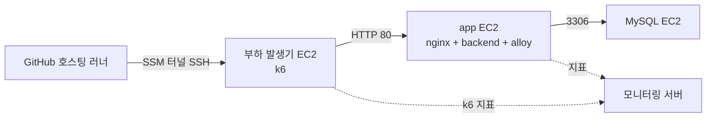

# 부하 테스트 전용 환경

부하 발생기, 앱(nginx + backend), MySQL을 EC2 3대로 만든다. 회차마다 스택을 만들고 끝나면 지운다. dev와 운영에는 부하를 보내지 않는다.

| 파일 | 역할 |
| --- | --- |
| `loadtest-environment.yaml` | CloudFormation 템플릿. VPC·서브넷, EC2 3대, 보안 그룹, SSM 접속용 역할 |
| `compose.app.yml` | 앱 서버 compose. 운영 compose에서 TLS·certbot을 뺐다 |
| `nginx.default.conf.template` | HTTP 전용 nginx 설정. 제한값은 환경 변수로 바꾼다 |
| `.github/workflows/loadtest-environment.yml` | 스택 생성·삭제 워크플로(수동 실행) |
| `.github/workflows/load-test.yml`의 `k6-loadtest` 잡 | `k6/loadtest/...` 태그로 부하 발생기에서 k6 실행 |

## 구성

- 보안 그룹: 부하 발생기는 인바운드 없음, app은 부하 발생기에서 80, MySQL은 app에서 3306만 허용한다. 22번 포트는 열지 않고, 워크플로가 SSM Session Manager(`AWS-StartSSHSession`)로 SSH한다.
- 앱은 `SPRING_PROFILES_ACTIVE=prod,loadtest`로 뜬다. `loadtest`가 모의 `ChatModel`을 켠다(#525). 모의 모델 설정은 `bibbidi.ai.loadtest.*`이며 Spring 환경 변수(`BIBBIDI_AI_LOADTEST_TTFT_MS` 등)를 `.env.spring`에 추가해 바꾼다.
- 인스턴스는 운영·dev 서버와 같은 Ubuntu 24.04(arm64, Canonical AMI)다. SSM 에이전트는 AMI에 snap으로 들어 있다.
- 부하 발생기에는 SSE 확장이 들어간 k6(`xk6-sse`)를 부팅 때 빌드해 둔다.

## 사전 설정 (한 번만)

GitHub `loadtest` 환경에 아래 값을 둔다. 이미 있는 저장소 시크릿 `DOCKERHUB_USERNAME`, `DOCKERHUB_TOKEN`, `BIBBIDI_ALLOY_ENV`(모니터링 토큰)는 그대로 쓴다.

| 종류 | 이름 | 내용 |
| --- | --- | --- |
| 변수 | `LOADTEST_AWS_ROLE_ARN` | OIDC로 가정하는 AWS 역할 |

AWS 역할에는 다음 권한이 필요하다: CloudFormation 스택 생성·삭제, VPC·EC2·보안 그룹 생성, 인스턴스 역할 생성(`iam:PassRole` 포함), `/bibbidi/loadtest/*` 경로의 SSM Parameter 쓰기·읽기·삭제, 부하 발생기 인스턴스로의 `ssm:StartSession`(`AWS-StartSSHSession` 문서).

JWT 비밀값, DB 비밀번호, SSH 키는 `create`가 회차마다 만든다. JWT 값과 개인키는 `/bibbidi/loadtest/<회차>/` 아래 SSM SecureString으로 저장되어 k6 잡이 읽고, `delete`가 지운다.

## 회차 절차

1. Actions의 `비비디 부하 테스트 환경`을 `create`로 실행한다(`round-id`, `image-tag`, 필요하면 `config-ref`). `ConfigRef` 기본값은 `dev-be`이므로 테스트할 compose·nginx 파일이 다른 브랜치에 있으면 그 ref를 넘긴다.
2. 스택은 인스턴스가 준비 신호(`cfn-signal`)를 보낸 뒤에 완료된다. 신호 조건은 아래와 같다. 실패하면 스택이 `CREATE_FAILED`가 되며, 인스턴스의 `/var/log/cloud-init-output.log`로 원인을 본다.
   - MySQL: 컨테이너가 TCP로 `mysqladmin ping`에 응답
   - 앱: backend의 `/actuator/health/readiness`(Flyway 적용과 DB 연결 포함)와 nginx `/healthz`가 응답하고, 로그의 활성 프로필에 `loadtest`가 있음
   - 부하 발생기: `k6 version` 성공
   - 지표: 모니터링 서버에서 `deployment.environment.name=loadtest` 지표 수집은 자동 확인하지 않는다
3. 시드 데이터를 복원한다(#528 절차가 생기면 여기에 연결한다).
4. 태그로 테스트를 시작한다: `git tag k6/loadtest/<스크립트>/<회차> && git push origin k6/loadtest/<스크립트>/<회차>`. 회차는 `create`의 `round-id`와 같아야 한다.
5. 끝나면 같은 워크플로를 `delete`로 실행한다. 스택과 SSM 파라미터를 함께 지운다.

## 운영 기능

접속은 SSM으로 한다. 예: `aws ssm start-session --target <인스턴스 ID>`.

| 하고 싶은 일 | 방법 |
| --- | --- |
| 새 버전 배포 | 앱 EC2에서 `/opt/bibbidi/loadtest/.env`의 `IMAGE_TAG`를 바꾸고 `docker compose pull backend && docker compose up -d` |
| nginx 제한 변경 | 같은 `.env`의 `NGINX_API_RATE_LIMIT`·`NGINX_API_CONN_LIMIT`를 바꾸고 `docker compose up -d nginx` |
| 인스턴스 중지·재시작 | 한 회차 안에서는 `aws ec2 stop-instances` / `start-instances`. 사설 IP는 유지된다 |
| 스택 업데이트 | `aws cloudformation deploy`를 같은 이름으로 다시 실행. EC2 `UserData`가 바뀌면 인스턴스가 교체되므로 DB 데이터가 사라진다 |

## 회차 기록

회차마다 아래를 테스트 Issue에 남긴다. 운영과 다른 값은 그대로 적는다.

- 백엔드 이미지 태그, `ConfigRef`, 인스턴스 타입 3종
- `MysqlImage`, `MysqlMaxConnections`, `MysqlBufferPoolSize`, `DbPoolSize`와 운영 값
- `NginxApiRateLimit`, `NginxApiConnLimit`와 운영 값(`burst=60`, `limit_conn 40`)
- 모의 모델 설정 값

## 알려진 한계

- DB와 부하 발생기의 자원 지표는 수집하지 않는다. 앱 EC2의 컨테이너 지표만 Alloy로 보낸다.
- MySQL 운영 값(버전·설정)은 이 저장소에서 확인되지 않아 템플릿 기본값(`mysql:8.0`, 기본 설정)이다. 회차 전에 운영 값과 맞춘다.
- 회차마다 VPC와 공개 서브넷(NAT 없음)을 새로 만든다. VPC 한도(리전당 기본 5개)를 넘지 않게 회차를 정리한다. 인스턴스는 공개 IP를 받지만 보안 그룹이 인바운드를 막는다.
- 팀 AWS 계정이 태그를 요구해 스택 생성이 거부되면 태그를 템플릿에 추가한다. 지금은 `Name` 태그만 붙인다.
- k6 워크플로는 SSM 세션 플러그인과 `ssh`가 GitHub 호스팅 러너에서 동작한다고 가정한다.
- 템플릿과 워크플로를 실제 AWS·GitHub에서 실행해 보지 못했다. `cfn-lint`, `docker compose config`, 워크플로 YAML 파싱만 확인했다.
